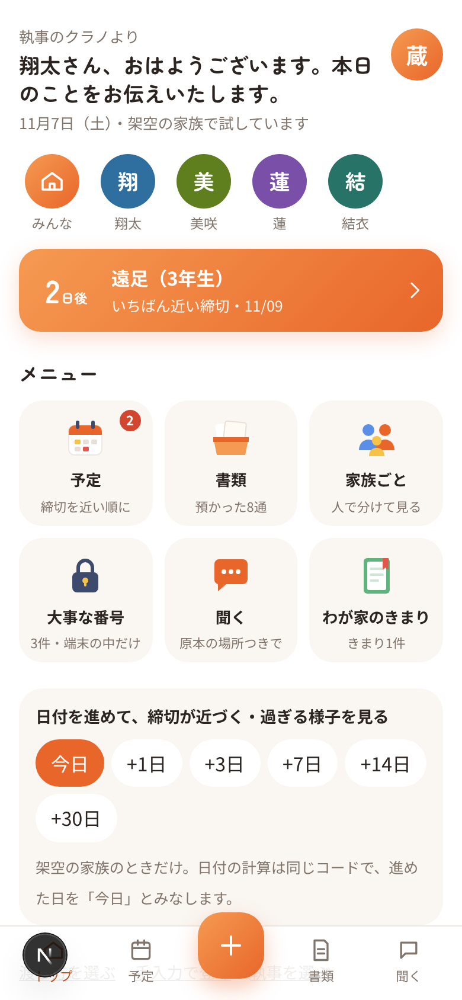
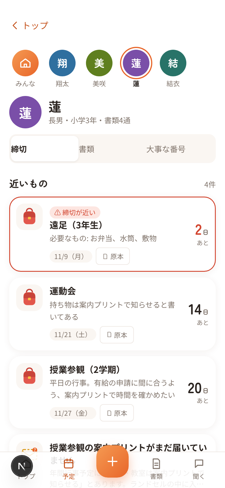
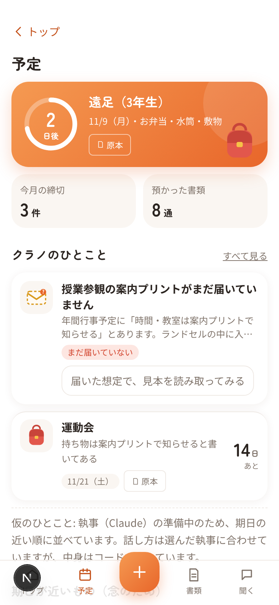
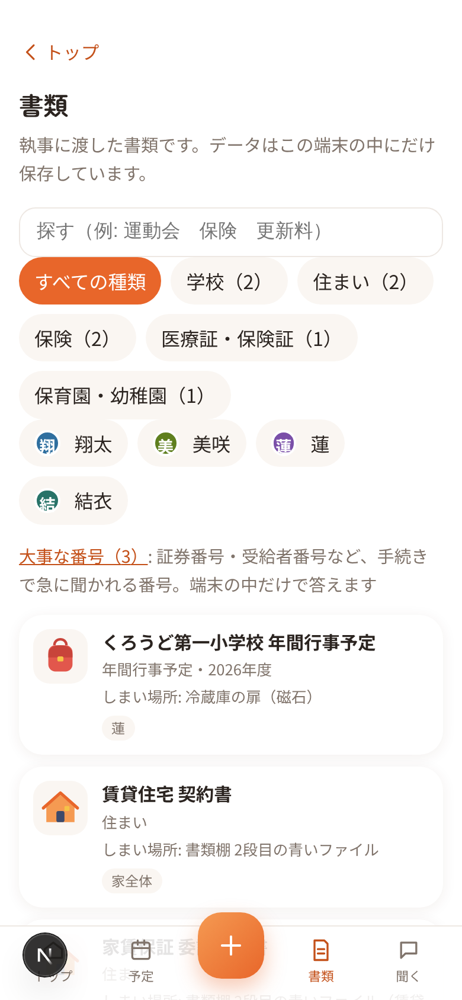

# CULALOG（クラログ）

Claude を活用した、暮らしのログ。

家に届く書類やプリント（学校・保育園のお知らせ、賃貸や保険の契約書、健診の案内、勤務先や町内会の通知など）を、
家族の「執事」に丸投げするスマートフォン向けの Web アプリです。

- 写真・スクショ・PDF を、何枚でもまとめて渡せます。執事（Claude）が1枚ずつ順番に読み、何の書類か・誰の書類かを考えて、
  「いつ・誰の・何を・どこで・何が必要・原本のどこに書いてあるか」の形にして溜めていきます。読み終わるのを待つ必要はありません
- 分からないところだけ、執事が「聞きたいこと」に並べ、選択肢で聞いてきます。答えたことは覚えて、同じ種類の書類では二度聞きません
- 開くとトップ（メニュー）。家族の丸いアイコン・いちばん近い締切・予定／書類／家族ごと／大事な番号／聞く／わが家のきまりの6つの入口があり、どの画面からも左上の「‹ トップ」で戻れます
- 「予定」には、今日〜近いうちに本当に大事なことだけを「執事のひとこと」として出します
- 家族の丸いアイコンを押すと、その人の締切・書類・大事な番号だけを見られます。住まい・光熱・保険などは「家全体」、誰のものか書類から分からないものは勝手に誰かに入れず「誰のか分からない」として執事が聞きます
- 執事は、書類同士やわが家のきまり（例: 「学校行事は有給を取る」）をつないで気づいたことを提案します。採用するかは本人が決めます
- 執事に聞く・頼むと、確定した今年度の書類だけを根拠に、どの書類のどこに書いてあるかを添えて答えます
- 期限の日付の計算はコードで行い、締切が近いものはひとことに入っていなくても必ず表示します

### 誰が、どんな場面で困るか

家族の書類をひとりで引き受けている人（共働きの親、別居の親の手続きも見ている人）のためのアプリです。
困るのは、だいたい「知っていれば防げた」場面です。

- 去年の似たプリントを見て、今年の日付を取り違えた
- 運動会の案内プリントがランドセルの中に入ったままで、有給の申請が間に合わなかった
- 賃貸の更新で、契約書・家賃保証・火災保険の3つを別々に読み直すことになった
- 手続きの窓口で、年金番号や受給者番号を急に聞かれた
- サブスクの解約できる時期を、次に気づいたときには過ぎていた

CULALOG は、撮っておいた書類から「いつ・誰の・何を・どこで・原本のどこ」を先回りして出し、
迷ったら原本の場所と問い合わせ先までを示します（判断はしません）。

### ハッカソンのあとも使い続けるために

- 毎日開く理由を置く: 今日の時間割・いちばん近い締切・執事のひとことは、書類が増えなくても毎朝変わります
- 書類は端末の中にだけ置き、Claude API を呼ぶのは読む・つなぐ・聞くときだけ。費用はその回数の分だけです
- 架空の家族を消して「自分の書類で始める」に切り替えれば、同じ画面がそのまま自分の家のものになります

大事にしているのは「中身は正確に、温度は柔らかく」です。
正確さ（原本のどこに書いてあるか・判断しないこと）は安心して任せてもらうための約束、
柔らかさ（執事の名前や口調、あいさつ）は続けて使ってもらうための工夫です。

> ハッカソン提出作品です。

| トップ（メニュー） | 蓮のページ | 予定 | 書類 |
|---|---|---|---|
|  |  |  |  |

（架空の家族・2026年11月7日の画面。画像は `node scripts/shots.mjs` で撮り直せます）

## 試し方

1. スマートフォンで https://culalog.vercel.app/ を開きます
2. 「架空の家族で試す」を押すと、デモ用の家族と書類が入ります
3. トップの「渡し方を選ぶ」から「写真の見本をまとめて渡す」を押すと、保育園の連絡アプリのスクショ・横向きのスキャン・何ページもある契約書・壁に貼った勤務カレンダーなど、
   架空の書類の写真が一度に受け取り箱に入ります。執事が1枚ずつ順番に読み、「まとめて確認」に種類ごとに並べます。
   誰の書類か分からないもの・同じ書類かもしれないもの・読めなかった所があるものはチェックが外れて⚠が付き、それ以外は一度に確定できます。
   同じ画面の「メールの見本をまとめて渡す」では、請求と督促・継続のご案内・納付完了・期限の訂正・転送されたメールなど、架空のメールを
   「本文を貼り付けて渡した」形で試せます（同じ予定のメールは1件に束ね、「納付完了」は、つながる予定を済んだにするか聞きます）
4. 「聞きたいこと」では、執事が読みながら分からなかったことを1問ずつ選択肢で聞きます（「あとで」も選べます）。
   答えると「覚えたこと」に残り、同じ種類のほかの書類にもその場で当てはめ、次からは聞きません。覚えたことは一覧から忘れさせることもできます
5. 「予定」の「執事のひとこと」から、届いていない運動会の案内プリントの見本を読み取って、原本と見比べて確定できます。
   原本の読み取った場所には蛍光ペンが引かれ、押すとその場所へ移ります
6. 「執事に聞く」で、「冬休みはいつからいつまで？」のように聞くと、確定した今年度の書類だけを根拠に、どの書類のどこに書いてあるかを添えて答えます。書いていないことは「書いていません」と答え、問い合わせ先だけを示します。
   「蓮が学校でけがをした。保険の条件と連絡先を調べておいて」のように頼んで画面を閉じても、答えは「予定」の「執事からの報告」に残ります（条件が書いてある場所と連絡先までを示し、お金が出るかどうかは判断しません）
7. 「火災保険の証券番号は？」「受給者証ってどこにある？」のように、めったに見ないのに手続きで急に聞かれる番号や書類を聞くと、
   Claude には送らず、この端末の中で確定した書類からコードで探して、番号（最初は伏せていて、「見る」を押したときだけ表示）・原本の場所・しまい場所を出します。
   書類の一覧の「大事な番号」にもまとめて並びます
8. 「書類の一覧」の一番下にある「この端末のデータをすべて消す」で元に戻せます

デモの家族・会社・書類はすべて架空で、このリポジトリのために期間中に新しく作ったものです。
デモの日付は開いた日を基準に作られるため、いつ開いても同じ流れを試せます。
ただし写真の見本は、2026年11月7日に撮った想定の画像のため、日付は動きません（開いた日によっては過ぎた予定もあります）。
登録したときにはもう過ぎていた締切は、トップ・予定で期限切れとして知らせず、すべての予定の画面にだけ「登録したときには、もう過ぎていました」と添えて残します。
Claude API のキーが設定されていないときは、見本の書類だけ、あらかじめ用意した「仮の結果」で流れを試せます。
仮の結果は Claude の答えではないため、画面にもそう表示します。

## まとめて渡す・聞きたいこと・覚えたこと

家に届く書類は、届いたときにきちんと整理できるとは限りません。
このアプリは「撮れるだけ撮って、まとめて渡すだけ」で済むように作っています。

- 渡す: 画面の下の「＋」から、そのまま何枚でも渡せます。渡す画面では、ドラッグ・貼り付けでも渡せます。何ページもある契約書や同じ封筒の郵便一式は「1つの書類のページ」（6ページまで）として1回で読みます。
  メールで届いた書類（更新のご案内・解約の受付・注文の確認など）は、本文を貼り付けると1件の書類として読み、原本の場所を本文の行・段落で示します（スクショや「PDF に保存」したメールは、そのまま渡せます）。
  同じ予定を知らせるメール（請求と督促・継続のご案内の1回目と2回目）は予定で1件に束ね、「納付完了」「決済完了」のメールを確定すると、つながる予定を済んだにするか聞きます。
  「お支払い期限の訂正」のように前の予定が置き換わるメールは、済んだのではなく「訂正されましたか？」と聞いて、前の予定だけを消します
- 読む: 受け取り箱に入った分を、執事が1枚ずつ順番に読みます。画面を閉じても、次に開いたときに続きから読みます。
  回数の上限に当たったら、時間をおいて自動で続けます。同じファイルは二度読まず、同じ書類の写真違いかもしれないものは「同じ書類ですか？」と聞きます
- 確かめる: 「まとめて確認」で、種類ごとに原本のサムネイルと日付を見て、一度に確定します。迷う理由があるものだけ外して残します
- 答える: 分からないことは「聞きたいこと」に1問ずつ並びます。空いた時間に選択肢を押すだけで答えられます
- 覚える: 答えは「覚えたこと」として端末の中に残り、同じ種類の書類では二度聞きません。覚えたことは Claude には送らず、読み取りのあとにコードで当てはめます

## Claude の使い方

このアプリの中心では、3つの場面で Claude API（claude-opus-5-5・構造化出力）を呼びます。
どの場面でも、Claude の答えをそのまま見せず、コードで原本や計算と照らし合わせてから出します。

| 場面 | Claude がすること | コードがすること |
|---|---|---|
| 読む（/api/extract） | 書類の画像・PDF から、何の書類か・誰の書類か・いつ・何を・どこで・何が必要・原本のどこに書いてあるか・原文の抜き書きを、決まった形で返す | 抜き書きを本文から探して原本に蛍光ペンを引く。本人が原本と見比べて確定するまで、根拠に使わない |
| つなぐ（/api/connect） | 確定した書類・予定・わが家のきまりを見て、今日のひとことと、書類同士をつないだ気づき（例: 運動会の雨天の予備日にも休みが要るかもしれない）を、候補・予定・書類の ID と言い回しで返す | ID が実在するか・文の中の日付が正しいか・判断の言い回しが無いかを照らし合わせ、合わないものは出さずに件数を表示する。期限が迫っているのに選ばれなかったものも必ず出す |
| 聞く（/api/ask） | 質問に、答え・引用（書類の ID・原本の場所・原文）・書いてあったかどうかを返す | 引用を原本の文字と照らし合わせ、判断の言い回しや書類に無い日付が混じった答えは出さない。書いていないときは問い合わせ先を示す |

守っている3つのこと:

- 日付の計算はコードで行う（Claude に日付を数えさせない）
- 採用するのは本人（Claude の提案は、本人がボタンを押すまで予定に入らない）
- 判断を書く欄を作らない（返す形そのものに「対象になります」などを書く場所が無い）

Claude を呼べないとき（API キーが無い・回数の上限など）は、読み取りは見本の書類だけ用意した「仮の結果」、
つなぐ・聞くはコードだけで作る「仮の気づき」「仮の答え」（キーワードの検索）で流れを試せます。
仮のものは Claude の答えではないため、画面に必ず「仮」と表示します。

## 想定している書類の範囲（40分野）

法定の様式の一覧ではなく、家庭の場面からの整理です。●は架空の見本を用意して読み取りを確かめたもの、○は同じ形で受けられる設計上の対象です。

| | 分野 | | 分野 |
|---|---|---|---|
| ● | 01 小学校の日常の連絡・学習・提出 | ● | 21 マンション・集合住宅の管理 |
| ● | 02 小学校の行事・校外活動・予定変更 | ● | 22 住宅設備・修理・保守 |
| ● | 03 学校の健康・安全・災害共済 | ● | 23 電気・ガス・水道・暮らしのサービス |
| ● | 04 給食・PTA・学童・費用 | ● | 24 通信・デジタル・サブスク |
| ● | 05 保育園・幼稚園の日常・行事・連絡アプリ | ● | 25 買い物・保証・配送・返品 |
| ● | 06 保育の入園・継続・認定 | ● | 26 自動車・運転免許・駐車場 |
| ● | 07 子育て行政・妊娠出産・乳幼児健診 | ● | 27 自転車・二輪・交通・レンタル |
| ● | 08 習い事・塾・スポーツ | ● | 28 銀行・カード・金融・支払い |
| ○ | 09 中学・高校・進学準備 | ● | 29 税金・公的保険料・申告・給付 |
| ○ | 10 大学・専門学校・奨学金 | ● | 30 身分証明・住所・引っ越し |
| ● | 11 仕事の雇用・勤務・社内手続き | ● | 31 旅行・宿泊・レジャー |
| ● | 12 給与・年末調整・社会保険・福利厚生 | ● | 32 町内会・自治体・防災・地域活動 |
| ● | 13 休業・休暇・復職・退職 | ○ | 33 ペット |
| ● | 14 パート・派遣・自営業・副業 | ○ | 34 別居の両親の年金・退職 |
| ● | 15 家族の通院・健診・予防 | ● | 35 別居の両親の医療・通院 |
| ○ | 16 入院・治療・薬・医療機器 | ● | 36 別居の両親の介護認定・費用 |
| ● | 17 医療の資格・助成・福祉 | ○ | 37 別居の両親の介護サービス・施設 |
| ● | 18 民間保険・共済・事故の請求 | ○ | 38 別居の両親の実家・見守り・生活支援 |
| ● | 19 賃貸住宅の入居・更新・退去 | ○ | 39 財産・意思・相続・葬祭 |
| ○ | 20 持ち家・住宅ローン | ● | 40 消費者トラブル・解約・返金 |

見本あり 31 分野／設計上の対象 9 分野。見本の書類はすべて架空で、期間中に新しく作ったものです。
崩れた紙・ややこしい書類の型（前年度と今年度で同じ件名、年度途中の改訂で1つの日付だけ変わる、実施日・回答締切・支払締切が全部違う、
曜日と年月日が一致しない、二つの書類で日付が食い違う、「別紙参照」なのに別紙がない、下の締切が切れている、手書きの訂正と印刷が混在、
QR の先にしか情報がない、申請のあとに不備・差戻し、解約受付のあとに最終請求 など）も見本に含め、推測で埋めずに「読めなかった所」として確認に回すことを確かめています。

## このアプリがしないこと

- 保険・医療・法律についての判断はしません（「補償されます」「解約して大丈夫です」などとは答えません）。
  示すのは「どの書類のどこに何と書いてあるか」と「問い合わせ先」だけで、最終的な確認は原本と各窓口でお願いします。
- 気づいたことは「〜かもしれません」という提案までです。言い切りません。
- 写真からの読み取りは登録の入口の一つです。手入力でも登録できます。
  読み取った内容は、本人が原本と見比べて確認してから確定します。

作りながら迷ったところと、選んだこと・理由は [docs/decisions.md](docs/decisions.md) にまとめています。

## データの扱い

- 書類のデータ（読み取った内容・写真・予定・受け取り箱に渡したファイル・覚えたこと）は、お使いの端末の中（ブラウザの IndexedDB）にだけ保存します。
  このアプリのサーバーやデータベースには保存しません。
- ただし、Claude に頼むときは、そのために必要な部分だけをこのアプリのサーバー経由で Claude API（Anthropic）に送ります。
  - 書類を読み取るとき: その書類の画像・PDF（1つの書類のページとして渡したときは、そのページすべて。貼り付けたメールなら、その文字）と、誰の書類かを考えるための家族の呼び名・続柄・メモ。覚えたことは送りません
  - 今日のひとことを選び、書類同士・わが家のきまりをつなぐとき（書類やきまりが変わったとき・1日1回）: 確定した書類の項目・予定・原本の場所、わが家のきまり、家族の呼び名・続柄・メモ。証券番号などの番号は伏せ、電話番号は送りません
  - 執事に聞くとき（「○○の番号は？」「○○持ってる？」は送らず、端末の中だけで答えます）: 確定した今年度の書類の中身（項目・予定・原本の文字・問い合わせ先の名前）と質問。番号は伏せ、電話番号は送りません。答えの引用は、端末の中でコードが原本と照らし合わせ、合わないものは出しません
  - サーバーは送られてきた内容を Claude API に渡して結果を返すだけで、保存しません。
    Claude API に送られた内容の扱いは Anthropic の規約によります。
- 公開 URL での使いすぎを防ぐため、Claude API を呼ぶ回数と、送る大きさに上限があります。

## これから

- メール（Gmail など）と読み取り専用でつなぐ: 本人が選んだラベル・差出人のメールだけを、端末の中で受け取り箱に入れる形を考えています。
  今回は作っていません。メールを読む権限には提供元の審査が必要で会期中に間に合わないこと、審査員の方が試せないこと、
  そして「書類のデータを預からない（端末の中にだけ置く）」という設計を守るためです。今は、メールの本文の貼り付け・スクショ・PDF で渡せます。

## 開発

```bash
npm install
cp .env.example .env.local   # ANTHROPIC_API_KEY を設定（未設定でも仮の結果で流れは動きます）
npm run dev
```

## 技術と構成

- Next.js（App Router）/ TypeScript / Claude API（@anthropic-ai/sdk）
- 書類のデータはブラウザの IndexedDB に保存し、サーバーはデータベースを持ちません
- 主なファイル
  - `src/lib/extraction.ts` 読み取りの形と検証 ／ `src/app/api/extract/route.ts`
  - `src/lib/connect.ts` つなぐの形と照らし合わせ ／ `src/app/api/connect/route.ts`
  - `src/lib/ask.ts` 聞くの形と照らし合わせ ／ `src/app/api/ask/route.ts`
  - `src/lib/deadlines.ts` 期限の計算 ／ `src/lib/butler.ts` ひとことの候補・安全網・聞きたいこと
  - `src/lib/inbox.ts` 受け取り箱・同じ書類の見分け・覚えたことの当てはめ・まとめて確定 ／ `src/lib/useInbox.ts` 1枚ずつ順番に読む
  - `src/lib/numbers.ts` 大事な番号を端末の中だけで探す
  - `src/lib/addToInbox.ts` 渡す（ファイル・ページ・見本） ／ `src/lib/files.ts` 画像を縮める・同じファイルの見分け
  - `src/data/` デモ用の架空の家族と書類

## 開発での Claude Code の使い方

開発は Claude Code（クラウドのセッション）を中心に進めました。

- Skills: Claude API を呼ぶコードを書く前に claude-api スキルで現行の書き方（構造化出力・effort など）を確かめる
- MCP: セッションをまたいで作業を引き継ぐため、非公開の作業メモ用リポジトリをセッションに付けて再開する
- 並行のセッション: アプリ本体と、デモ用の架空書類・動画の台本づくりを別々のセッションで並走させる
- プロジェクトのスキル（`.claude/skills/demo-check`）: デモの流れを通しで確かめる手順をスキルにまとめ、画面や「聞く」「つなぐ」を変えたあと・main に入れる前・本番の反映後に同じ確認を回す（`node scripts/smoke.mjs [URL]`）
- 動作確認: セッションの中の Playwright でスマホ幅の画面を通しで操作し、時計を固定して日付に関わる機能を確かめる。
  Claude API の返事を差し替えて、間違った答え（ありえない ID・違う日付・判断の言い回し）をコードが外すかも確かめる
