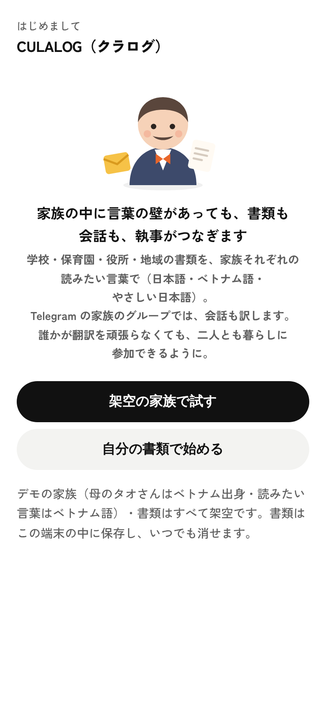
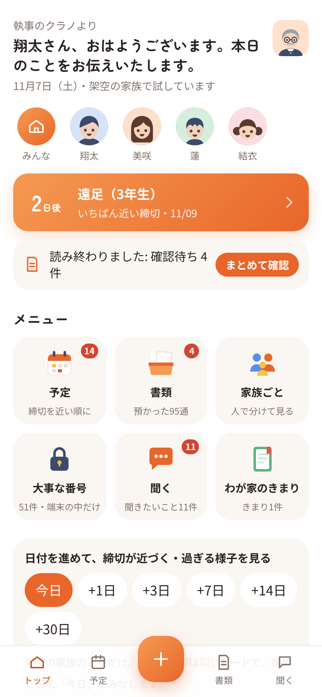
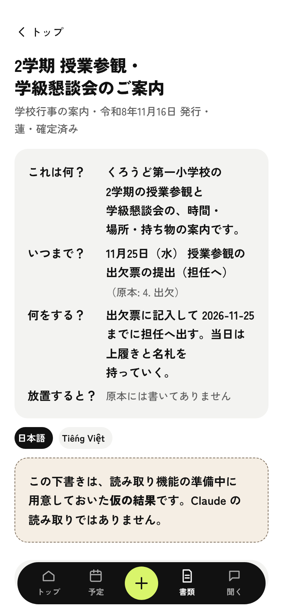
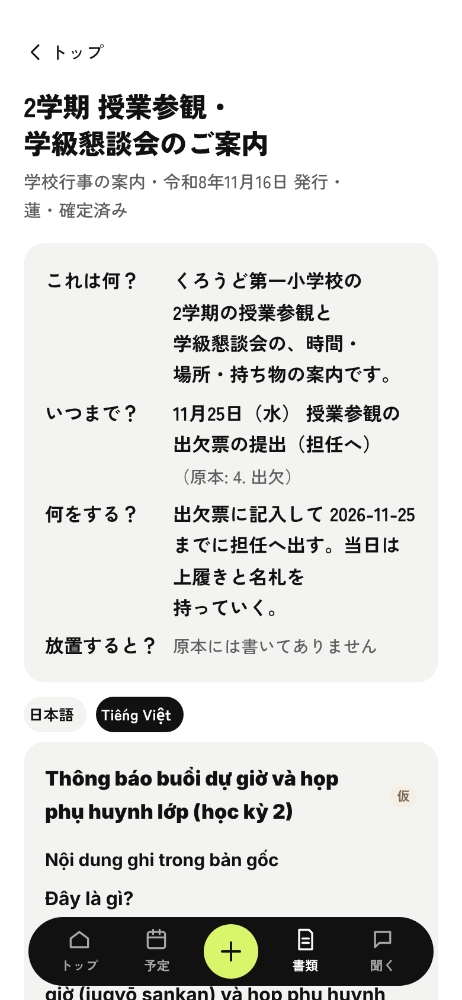
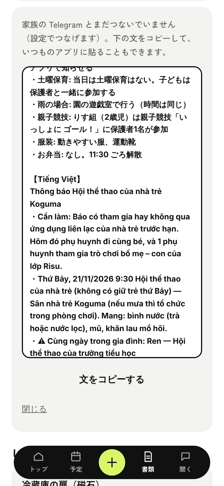
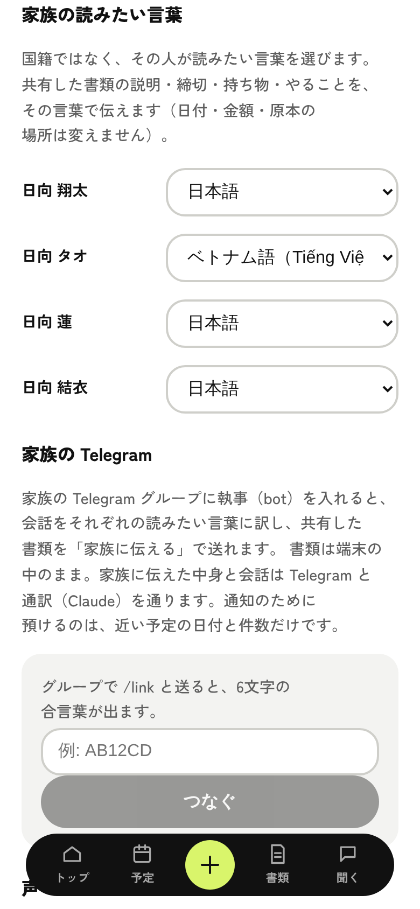
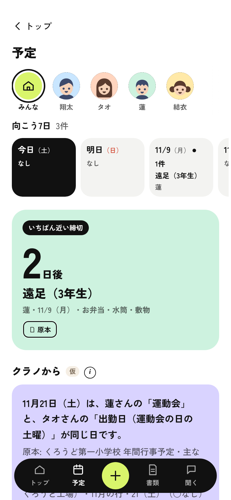
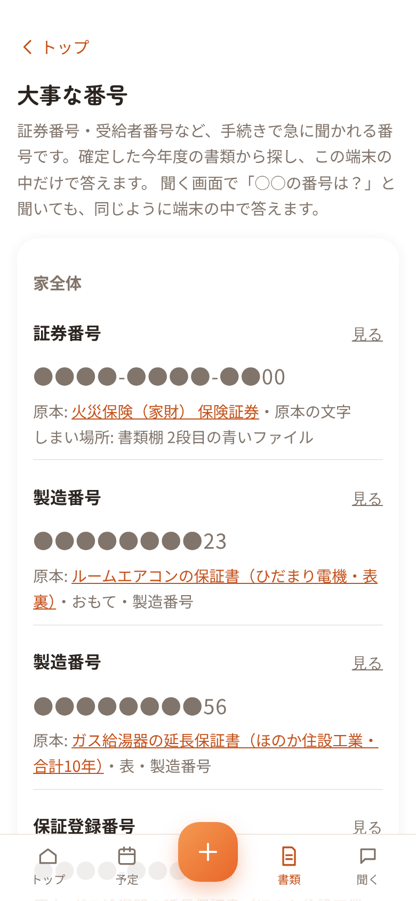

# CULALOG（クラログ）

Claude を活用した、暮らしのログ。

**家族の中に言葉の壁があっても、書類も会話も、執事がつなぐ。**

学校・保育園・役所・地域から家に届く書類を家族の「執事」に預けると、家族それぞれの読みたい言葉で読め、
家族の予定とつないで気づき、家族の Telegram のグループでは会話も訳す。スマートフォン向けの Web アプリです。

デモ動画（3分）: https://youtu.be/KwijEubkKDA

執事は家族に1体です。書類（原本の写真・全文）を預かるのは1人の端末ですが、家族に返すときは、その人の読みたい言葉と言葉の易しさで返します。
大人には、それぞれの執事との1対1にお知らせ・答えをその人の言葉で届け、やさしい日本語で読む人（子ども）には、家族の Telegram のグループの通訳をやさしい日本語で返します（1対1・お知らせは大人だけです）。
夫も妻も、相手に何が届いたかを自分の言葉で確かめられ、訳した文からは原本に戻れます。

### 作った理由

作者の家は国際結婚で、妻はベトナム出身です。夫婦とも相手の言葉は片言で、
学校や保育園のプリントが届くたびに、夫が読んで・AI に訳させて・コピーして・貼って・説明する、を毎日くり返していました。

書類を撮れば AI が読んでくれるアプリは、もうあります。困っていたのはその先でした。
訳した文には「その日は妻も夫も仕事だ」「夫のシフト表では、休みの希望は前の週の金曜まで」とは書いてありません。訳すだけでは、もう一人は暮らしのことを自分で確かめる手段がないままです。

CULALOG は、**訳すだけではなく、つなぎます。**

### いちばん伝えたい3つ

1. **家族の書類を持っているから、同じ日に気づけます。** 授業参観（平日）の案内プリントを預けると、妻の勤務カレンダーと夫の勤務シフト表から「その日は二人とも仕事」だと、
   トップでそのまま知らせます。どちらが行くか（行かないか）も、どう休むかも決めません（家族で決めてください）。休みの申し出の期限は、勤務の書類そのものに書いてあるときだけ、その書類の名前つきで添えます。日付は訳さず、元の予定からコードで入れます
2. **家族それぞれの読みたい言葉で、原本に戻れます。** 書類の画面で「Tiếng Việt」を押すと、①原本に書いてあること（押すと原本のその行が光る）
   ②理解を助ける一般的な説明（「授業参観とは」「学級懇談会とは」。この学校の決まりではない、と札を付けて分ける）③原本からは分からないので確かめること、の3つに分けて出します。
   国籍ではなく「その人が読みたい言葉」を家族ごとに選びます（日本語・ベトナム語・やさしい日本語）
3. **会話もつなぎます。執事は家族に1体。** 家族の Telegram のグループでは、会話をほかの人の読みたい言葉にして返します（通訳だけ）。
   大人はそれぞれ執事と1対1で話します。共有した書類の「家族に伝える」・毎朝の通知・担当のボタン・カレンダーのボタンは、その人の1対1に、その人の言葉だけで届きます。
   1対1で聞けば共有した書類のまとめから答え、書類の写真を送れば読んでまとめ、「夫に伝えて」と書けば相手の1対1に相手の言葉で伝えます

執事の答えには必ず、その答えが書類のどこに書いてあるかが付きます。保険・医療・法律・在留の手続きの判断はせず、原本の場所と問い合わせ先までを示します。

| はじめて開いたとき | トップ（同じ日の気づき） | 書類（日本語） | 書類（Tiếng Việt・原本の場所を押すと原本の行が光る） |
|---|---|---|---|
|  |  |  |  |

| 家族に伝える（送る前の全文） | 家族の読みたい言葉・家族の Telegram | 予定（向こう7日・いちばん近い締切） | 大事な番号（端末の中だけで答える） |
|---|---|---|---|
|  |  |  |  |

（架空の家族で、2026年11月7日の画面。画像は `node scripts/shots-final.mjs <出力フォルダ> [URL]` で撮り直せます。Telegram の画面は、本物の家族の会話が映るため載せていません）

### できること

- **読みたい言葉**: 家族ひとりずつ「読みたい言葉」を選びます（設定）。書類を共有した人には、その言葉で説明・締切・持ち物・やることを伝えます。日付・金額・原本の場所は変えません
- **家族と共有**: 書類ごとに、家族の誰と共有するかを選びます。配偶者でも自動では共有しません。書類の一覧は、共有している書類が主役です
- **読む言葉**: 書類の画面で、日本語とその人の言葉を切り替えます。訳は、原本に書いてあることだけ（足さない・省かない）。一般的な説明は札を付けて分け、確かめることを添えます
- **同じ日の気づき**: 保護者が行く子どもの行事（授業参観・懇談会・面談など。学校・保育園・地域の書類で、時間まで分かっているもの）の日に、家族の大人が仕事（勤務カレンダー・勤務シフト表の書類）なら、トップ・予定・その人のページで知らせます。個別懇談会の「候補日①〜④」のように候補日から選ぶ行事は1枚にまとめ、候補日のうち誰がお仕事の日か（勤務の書類で休日の日・まだ勤務の書類が無い月も）を並べます。どの日を希望するかは家族が決めます。トップは1枚だけ（子どもの行事を先に）で、ほかは予定の画面に並べます。
  町内会・自治会の清掃・当番も、日にちと時間が書いてある回覧なら同じように知らせます（「12月中」のような期間だけの当番は出しません）。
  二人とも仕事なら二人とも書きます。休み方（有給・欠勤・交代・行かない）はその家が決めることなので、執事は「有給」と言いません。期限は勤務の書類に書いてある人の分だけ添えます（例: 「翔太さんのシフト表: 休みの希望・シフトの交代は11月20日（金）まで」）。運動会のような家族みんなで行く行事や、病院の予約同士など子どもの体のことは出しません。
  候補（どの行事の日に、誰がどの勤務の書類で仕事か・勤務の書類に書いてある申し出の期限）はコードが日付から集め、Claude が書類の行から、原本の場所つきの文を書きます。コードが日付・名前・期限を候補と照らし合わせ（「有給」などの休み方の言葉も外す）、合わなければコードの文に戻します（Claude の文のときだけ、カードに小さく「Claude が照らし合わせました」）
- **家族に伝える**: 共有した書類のまとめを、あなたと共有した大人それぞれの執事との1対1へ、その人の言葉の段だけで送ります（夫には日本語、妻にはベトナム語）。送る前に、だれに何が届くかと全文を見せます。同じ日の家族の予定（⚠）と原本の引用（紙の順）も添えます。まだ1対1を始めていない人・Telegram とつないでいないときは、文をコピーしていつものアプリに貼れます
- **Telegram の通訳（家族のグループ）**: 家族のグループに執事（bot）を入れると、会話をほかの人の読みたい言葉にして同じグループに返します（グループには通訳だけを出し、お知らせは流しません）。`/lang ja`・`/lang vi`・`/lang easy` で自分の言葉、`/pause`・`/resume` で止める・再開、`/link` でアプリとつなぐ合言葉
  - おまけの良さ: 訳は元のメッセージへの返信として届くので、相手の原文と執事の訳がいつも並んで見えます。毎日の家族の会話の中で、相手の言葉（日本語・ベトナム語）にも少しずつ触れられます（使ってみて分かった良さで、日本語の勉強にもなります）
- **執事との1対1（大人それぞれ）**: グループで言葉を決めた大人が、執事に1対1で `/start` を送り、家族の名簿から自分を選ぶと始まります（家族の名簿とつながっていない人には、執事は何もしません）。
  1対1で質問すると、聞いた人と共有している書類のまとめだけを根拠に、その人の言葉で答えます（書いていなければ「書いていない・原本と窓口へ」）。
  書類の写真を送ると、執事が読んでその人の言葉で要約を返し、書類を預かる人のアプリに「預かる？」を届けます（写真は残しません）。「○○に伝えて」は、相手の1対1に相手の言葉で伝えます
- **担当を決める**: 1対1に届いたお知らせの「タオがやる」「Thảo sẽ lo việc này」のボタンで担当を決めると、お知らせを受け取った人それぞれの1対1に、その人の言葉で「タオさんが担当します」と知らせます
- **その人の言葉でカレンダーに**: 1対1に届いたお知らせの下に、その人の言葉の「📅 カレンダーに追加」「📅 Thêm vào lịch」のボタンを付けます。その言葉の題とメモ（原本の書類の名前と「原本で確かめて」つき）で、Google カレンダーの人には予定を作る画面、iPhone のカレンダーの人には予定を入れるリンク（推測できない合言葉つき・30日で切れる）が開きます。iPhone・iPad では先に案内のページが開き、緑のボタンで Safari に移って「すべて追加」で入ります（Telegram の中のブラウザは .ics を開けないため）。ふだん使うカレンダーは家族ごとに設定で選びます。行事が1件だけの書類（案内プリントなど）に付けます
- **毎朝の通知**: 近い予定があれば、朝7時（日本時間）に、執事と1対1を始めた大人それぞれへ、その人と共有した書類の7日以内の予定の名前と日付（上から3件＋「ほかに○件」）をその人の言葉で送ります（例:「🔔 7日以内の予定／・11/9（月） 遠足（3年生）」）。済んだ予定は出しません。日本語以外の予定の名前は朝に1回だけ Claude で訳し、訳せないときは「近い予定が○件あります」の件数だけの文にします
- 写真・スクショ・PDF・メールの本文を、何枚でもまとめて渡せます。執事（Claude）が1枚ずつ読み、「いつ・誰の・何を・どこで・何が必要・原本のどこに書いてあるか」の形にして溜めます。分からないところだけ「聞きたいこと」に並べ、選択肢で聞きます。答えは覚えて、同じ種類の書類では二度聞きません
- 家族の丸いアイコンを押すと、その人の締切・書類・大事な番号だけを見られます。誰のものか書類から分からないものは勝手に誰かに入れず、執事が聞きます
- 執事は、書類同士やわが家のきまり（例: 「勤務先への休みの申請は1週間前まで」）をつないで気づいたことを提案します。授業参観（平日）は「見に行きますか？」と聞き、「行く」ときだけ、わが家のきまりの締切を予定に入れます。採用するかは利用者が決めます
- 予定は、いつものカレンダー（iPhone・Android・Google カレンダー）に入れられます（アプリの中に別のカレンダーは作りません）
- 執事に聞く・頼むと、確定した今年度の書類だけを根拠に、どの書類のどこに書いてあるかを添えて答えます。声でも話せます
- 書類が無いことも、執事に話すだけで覚えます（例: 「年に1回しか解約できないサブスク、次は3月。その前に教えて」）。確定したら締切の前から知らせます
- めったに見ない番号（保険の証券番号・受給者番号など）は、Claude に送らず端末の中でコードが探して出します
- 期限の日付の計算はコードで行い、締切が近いものは必ず表示します

### 誰が、どんな場面で困るか

一緒に住んでいる家族の書類を、ひとりで引き受けている人のためのアプリです。
家族の中に言葉の壁があると、その人は「読む係・訳す係・説明する係・伝える係」を全部ひとりで持つことになります。日本人だけの家族でも、書類の部分はそのまま使えます。

- 授業参観（平日）の案内プリントの日、夫婦とも仕事だった。夫のシフト表には休みの希望の期限も書いてあった。訳した文には、どれも書いていない
- 「学級懇談会」を訳しても、何をする集まりかが伝わらない。説明を足すと、今度はこの学校の決まりなのか一般論なのか分からなくなる
- 妻がプリントの内容を自分で確かめる手段がなく、夫に聞くしかない。夫が忙しいと、聞くのをあきらめる
- 授業参観の案内がランドセルの中に入ったままで、休みの申し出が間に合わなかった
- 手続きの窓口で、年金番号や受給者番号を急に聞かれた

CULALOG は、家族の書類と予定を一か所に持ち、それぞれの読みたい言葉で「原本のどこに何と書いてあるか」まで戻れるようにします。
判断はせず、迷ったら原本の場所と問い合わせ先までを示します。

> ハッカソン提出作品です。

## 試し方

1. スマートフォンで https://culalog.vercel.app/ を開きます
2. 「架空の家族で試す」を押すと、デモ用の家族（日向家。母のタオさんはベトナム出身・読みたい言葉はベトナム語）と、写真・メールの見本から確定済みの書類が入ります
3. トップに「タオさんはベトナム語・蓮さんはやさしい日本語で読みます」と、**同じ日の気づき**（11月27日（金）は、蓮さんの「授業参観（2学期）」の日です。この日は、タオさんも翔太さんもお仕事のようです）が出ます。
   原本は3つとも書類の中にあります（学校の案内プリント・壁に貼った妻の勤務カレンダーの写真・夫の勤務シフト表）。翔太さんのシフト表に書いてある、休みの希望・シフトの交代の期限（11月20日）も添えます（タオさんの勤務カレンダーには期限が書いていないので、何も言いません）
4. 「書類」から「2学期 授業参観・学級懇談会のご案内」を開き、「Tiếng Việt」→「ベトナム語（Tiếng Việt）にする」を押すと、原本に書いてあること・一般的な説明（札つき）・確かめること、に分けて出ます。
   原本の場所を押すと、下の原本のその行が光ります
5. 同じ画面の「家族と共有」でタオさんにチェックが入っています。「家族に伝える（それぞれの言葉で）」を押すと、送る前の画面で全文（日本語とベトナム語・⚠ 同じ日の家族の予定・原本の引用）を確かめられます。
   Telegram とつないでいないときは「文をコピーする」でいつものアプリに貼れます
6. 右上の執事 → 設定の「家族の読みたい言葉」で、家族ごとの言葉を変えられます（ベトナム語で読む家族へのお知らせでは、名前も「ほかの言葉での呼び名」で書きます）。「家族の Telegram」は、グループで `/link` と送ると出る6文字でつなぎます
7. 「＋」から、写真・メールの見本をまとめて渡せます（保育園の連絡アプリのスクショ・横向きのスキャン・何ページもある契約書・壁の勤務カレンダーなど）。執事が1枚ずつ読み、「まとめて確認」に並べます。
   本番で本物の Claude（Opus 5.5）が読む見本は「個別懇談会の開催について」です（「＋」の写真の見本の下に「本物の Claude が読む見本」のボタンがあります）。料金と回数の上限のため、ほかの見本は用意した仮の結果です
8. 「予定」では、行事について執事が「見に行きますか？」のように聞きます（どの行事を聞くかは執事が選びます）。「聞く」では「冬休みはいつからいつまで？」のように聞くと、どの書類のどこに書いてあるかを添えて答えます。
   「火災保険の証券番号は？」は Claude に送らず、端末の中で探して答えます
9. 設定の一番下「この端末のデータをすべて消す」で元に戻せます

Telegram の通訳・1対1の答え・担当・毎朝の通知は、執事（bot）を家族のグループに入れて試す部分です。流れは提出の動画でご覧ください。
`/?demo=few` で開くと、書類が少ない状態（11件）から始まります（「渡す前 → 後」を見るため）。

デモの家族・会社・書類はすべて架空で、このリポジトリのために期間中に新しく作ったものです。
デモの日付は開いた日を基準に作られます。写真・メールの見本は 2026年11月7日に撮った想定で日付が動かないため、11月7日〜27日に開いたときは、開いた日から作る書類も11月7日を基準にして、見本と同じ日にそろえます（開いた日によっては過ぎた予定もあります）。
Claude API のキーが設定されていないときは、読み取りは見本の書類だけ、訳は見本のうち10件（ベトナム語7件・子どもに関係する書類のやさしい日本語3件）だけ、あらかじめ用意した「仮の結果」で流れを試せます。
仮の結果は Claude の答えではないため、画面にもそう表示します。

## Claude の使い方

このアプリでは、アプリの4つの場面と、Telegram の執事の4つの場面で Claude API（claude-opus-5-5・構造化出力）を呼びます。
どの場面でも、Claude の答えをそのまま見せず、コードで原本や計算と照らし合わせてから出します。

| 場面 | Claude がすること | コードがすること |
|---|---|---|
| 読む（/api/extract） | 書類の画像・PDF から、何の書類か・誰の書類か・いつ・何を・どこで・何が必要・原本のどこに書いてあるか・原文の抜き書きを、決まった形で返す | 抜き書きを本文から探して原本に蛍光ペンを引く。利用者が原本と見比べて確定するまで、根拠に使わない |
| 訳す（/api/translate） | 本人が確かめた書類の中身（題名・説明・項目・予定の名前）を、読みたい言葉で「原本に書いてあること」「一般的な説明」「確かめること」に分けて返す。原本の場所は項目の ID で返す | 日付は送らず、元の予定からその言葉の形で入れる。ID が実在する項目だけを出す。一般的な説明には「この学校・園の決まりではない」の札を付ける |
| つなぐ（/api/connect） | 確定した書類・予定・わが家のきまりを見て、今日のひとことと、書類同士をつないだ気づきを、候補・予定・書類の ID と言い回しで返す | ID が実在するか・日付が正しいか・判断の言い回しが無いかを照らし合わせ、合わないものは出さない。同じ日の気づき（保護者が行く子どもの行事・町内会の当番 × 大人の勤務）は、コードが見つけた候補に Claude が文を書き、日付・名前・申し出の締切が候補と合い、「有給」など休み方を決めつける言葉や誰が行くかを決める言い方が無いときだけ出す（合わなければコードの文）。候補日から選ぶ行事（個別懇談会の候補日など）はコードの文だけ |
| 聞く（/api/ask） | 質問に、答え・引用（書類の ID・原本の場所・原文）・書いてあったかどうかを返す | 引用を原本の文字と照らし合わせ、判断の言い回しや書類に無い日付が混じった答えは出さない。書いていないときは問い合わせ先を示す |
| 通訳（/api/telegram・家族のグループ） | 家族の会話を、ほかの人の読みたい言葉にする（ベトナム語の呼び方を合わせるため、送った人の役割（夫・妻・子）だけを添える） | 訳を元のメッセージへの返信としてグループに返す。グループには通訳だけを出し、お知らせは流さない。コマンドは Claude を呼ばずコードで作る |
| 1対1の答え・伝言（/api/telegram・執事との1対1） | 質問に、家族の置き場所にある「聞いた人と共有している書類のまとめ」だけを根拠に、その人の言葉で答える。「○○に伝えて」は相手の言葉の文にする | 名簿とつながった大人の1対1だけ受け付ける。根拠に渡すのは、聞いた人と共有している書類のまとめだけ（書類を預かる人には全部。共有していない書類はあることも言わない。原本の全文・引用・番号の類は置き場所に入る前に落としてある）。担当の知らせ・お知らせ・カレンダーのボタンは Claude を呼ばずコードで作る |
| 1対1の写真（/api/telegram） | 1対1に送られた書類の写真を、アプリの「読む」と同じ指示で読み、送った人の言葉で要約する | 写真は残さない。読み取りの結果から原本の全文・引用・番号の類を落とし、共有したまとめと、書類を預かる人のアプリへの「預かる？」として置く |
| 朝の通知（/api/notify） | 日本語以外で読む人の、7日以内の予定の名前を訳す（名前だけ。1日1回） | 予定・日付・件数はコードが選ぶ。訳せないときは件数だけの文にする |

守っている3つのこと:

- 日付の計算はコードで行う（Claude に日付を数えさせない・訳させない）
- 採用するのは利用者（Claude の提案は、利用者がボタンを押すまで予定に入らない。送る文は、送る前に全部見せる）
- 判断を書く欄を作らない（返す形そのものに「対象になります」などを書く場所が無い。一般的な説明は、原本に書いてあることと別の欄）

### 正解と照らし合わせて測る

読み取りには、架空の見本86件（写真62・メールの本文24）に正解を付けてあります。
`npx tsx --tsconfig tsconfig.json scripts/eval-extraction.mts --claude` の1コマンドで、見本を本物の Claude に読ませ、
正解と項目ごと（書類の種類・誰の・家全体・期間・予定の名前と日付・種類・電話番号・読めなかった所・リンク先だけ・済んだ／訂正・判断の言い回し）に突き合わせ、
正解率の表と料金の見積もりを [docs/eval/latest.md](docs/eval/latest.md) に書き出します。
数え方は同じファイルの末尾に。日付の規則や「読めるか」の判断は人が見て、スクリプトは数えるだけです。

Claude を呼べないとき（API キーが無い・回数の上限など）は、読み取りは見本の書類だけ用意した「仮の結果」、訳は見本10件（ベトナム語7件・やさしい日本語3件）だけの「仮の訳」、
つなぐ・聞くはコードだけで作る「仮の気づき」「仮の答え」で流れを試せます。Telegram の通訳と返信の答えは「執事の準備中です」と返します。
仮のものは Claude の答えではないため、画面に必ず「仮」と表示します。

## 想定している書類の範囲（40分野）

法定の様式の一覧ではなく、家庭の場面からの整理です。●は架空の見本を用意して読み取りを確かめたもの、○は同じ形で受けられる設計上の対象です。CULALOG が預かるのは一緒に住んでいる家族の書類で、離れて暮らす家族（34〜39、「後」の印）はハッカソンのあとに広げたい範囲です。

| | 分野 | | 分野 |
|---|---|---|---|
| ● | 01 小学校の日常の連絡・学習・提出 | ● | 21 マンション・集合住宅の管理 |
| ● | 02 小学校の行事・校外活動・予定変更 | ● | 22 住宅設備・修理・保守 |
| ● | 03 学校の健康・安全・災害共済 | ● | 23 電気・ガス・水道・暮らしのサービス |
| ● | 04 給食・PTA・学童・費用 | ● | 24 通信・デジタル・サブスク |
| ● | 05 保育園・幼稚園の日常・行事・連絡アプリ | ● | 25 買い物・保証・配送・返品 |
| ● | 06 保育の入園・継続・認定 | ● | 26 自動車・運転免許・駐車場 |
| ● | 07 子育て行政・妊娠出産・乳幼児健診 | ● | 27 自転車・二輪・交通・レンタル |
| ● | 08 習い事・塾・スポーツ | ● | 28 銀行・カード・金融・支払い |
| ○ | 09 中学・高校・進学準備 | ● | 29 税金・公的保険料・申告・給付 |
| ○ | 10 大学・専門学校・奨学金 | ● | 30 身分証明・住所・引っ越し |
| ● | 11 仕事の雇用・勤務・社内手続き | ● | 31 旅行・宿泊・レジャー |
| ● | 12 給与・年末調整・社会保険・福利厚生 | ● | 32 町内会・自治体・防災・地域活動 |
| ● | 13 休業・休暇・復職・退職 | ○ | 33 ペット |
| ● | 14 パート・派遣・自営業・副業 | 後 | 34 別居の両親の年金・退職 |
| ● | 15 家族の通院・健診・予防 | 後 | 35 別居の両親の医療・通院 |
| ○ | 16 入院・治療・薬・医療機器 | 後 | 36 別居の両親の介護認定・費用 |
| ● | 17 医療の資格・助成・福祉 | 後 | 37 別居の両親の介護サービス・施設 |
| ● | 18 民間保険・共済・事故の請求 | 後 | 38 別居の両親の実家・見守り・生活支援 |
| ● | 19 賃貸住宅の入居・更新・退去 | 後 | 39 財産・意思・相続・葬祭 |
| ○ | 20 持ち家・住宅ローン | ● | 40 消費者トラブル・解約・返金 |

見本あり 29 分野／設計上の対象 5 分野（中学・高校、大学、持ち家、ペットはデモの家族の設定に無いため、入院・治療・医療機器は同居の家族の見本が無いため、見本を作っていません）／ハッカソンのあとに 6 分野。見本の書類はすべて架空で、期間中に新しく作ったものです。

離れて暮らす親の書類は、同居の家族が当事者のもの（介護休業の承認、付き添いの予定など）だけを扱います。親あての書類は「この家の書類ではない」として家族の情報にしません。見本にはこの見分けを確かめるための親あての書類も入れています。

崩れた紙・ややこしい書類の型（前年度と今年度で同じ件名、年度途中の改訂で1つの日付だけ変わる、実施日・回答締切・支払締切が全部違う、
曜日と年月日が一致しない、二つの書類で日付が食い違う、「別紙参照」なのに別紙がない、下の締切が切れている、手書きの訂正と印刷が混在、
QR の先にしか情報がない、申請のあとに不備・差戻し、解約受付のあとに最終請求 など）も見本に含め、推測で埋めずに「読めなかった所」として確認に回すことを確かめています。

## このアプリがしないこと

- 保険・医療・法律・在留の手続きについての判断はしません（「補償されます」「解約して大丈夫です」「この手続きで在留資格は大丈夫です」などとは答えません）。
  示すのは「どの書類のどこに何と書いてあるか」と「問い合わせ先」だけで、最終的な確認は原本と各窓口でお願いします。
- 訳は、原本に書いてあることだけです。理解を助ける一般的な説明は「この学校・園の決まりではない」と札を付けて分け、その園の決まりとして混ぜません。
- 誰が行くか・誰がやるかは決めません。同じ日だと知らせ、担当は家族がボタンで決めます。
- 気づいたことは「〜かもしれません」という提案までです。言い切りません。
- 写真からの読み取りは登録の入口の一つです。手入力でも登録できます。読み取った内容は、利用者が原本と見比べて確認してから確定します。
- 配偶者でも、書類を自動では共有しません。共有する書類・伝える文は、利用者が選んで確かめてから出します。

作りながら迷ったところと、選んだこと・理由は [docs/decisions.md](docs/decisions.md) にまとめています。

## データの扱い

ひとことで言うと: **原本（写真・全文）と大事な番号は端末の中。家族と共有した書類のまとめだけを、家族ごとに分けたサーバーの置き場所に置く。置かないものはコードで線を引いている。**

- 書類のデータ（読み取った内容・写真・予定・訳・受け取り箱に渡したファイル・覚えたこと）は、お使いの端末の中（ブラウザの IndexedDB）に保存します。
- **家族と共有した書類のまとめは、サーバー（Google の Firebase・Firestore）の家族の置き場所に置きます。** 執事が1対1で家族の質問に答え、お知らせを届けるためです。
  - 置くもの: 共有した書類の題・種類・誰の書類か・共有した相手・予定（名前・日付・時間・場所・持ち物・済んだか）・項目・やること・訳・問い合わせ先の電話・現物のしまい場所、家族の名簿（呼び名・読みたい言葉・ふだん使うカレンダー・家族の中の役割（夫・妻・子））
  - **置かないもの**: 写真・原本の全文・原本の引用・大事な番号（保険証・口座・カード・マイナンバー・パスワードなど）。項目の名前が番号の類のものは値ごと落とし、値の中の番号の形（6桁以上の数字の並び。日付・時刻・問い合わせ先の電話の形は残す）は伏せます。アプリが送るときとサーバーが受け取るときの両方で同じ線を引きます（`src/lib/familyShare.ts`）
  - 家族（つないだ Telegram のグループ）ごとに分け、アプリとつないだときの合言葉が合うときだけ読み書きします。共有をやめた書類のまとめは次の同期で消え、設定の「家族の置き場所のまとめを全部消す」で全部消せます（つなぐのをやめても消えます）
- Claude に頼むときは、そのために必要な部分だけをこのアプリのサーバー経由で Claude API（Anthropic）に送ります。
  - 書類を読み取るとき: その書類の画像・PDF（貼り付けたメールなら、その文字）と、誰の書類かを考えるための家族の呼び名・続柄・メモ。覚えたことは送りません
  - 訳すとき: 本人が確かめたその書類の中身（題名・説明・項目・予定の名前）と読みたい言葉。日付は送らず、番号は伏せます
  - つなぐとき・聞くとき: 確定した書類の項目・予定・原本の場所、わが家のきまり、家族の呼び名・続柄・メモ。番号は伏せ、電話番号は送りません。「○○の番号は？」は送らず端末の中だけで答えます
  - 1対1で聞かれたとき: 家族の置き場所にある、聞いた人と共有している書類のまとめと、家族の名簿
  - 朝の通知（日本語以外の人）: 7日以内の予定の名前（上から3件）だけ
  - 声で話すとき: 声を文字にするのはお使いのブラウザーの音声認識です（Chrome は Google、Safari は Apple のサーバーを使うことがあります）。声は CULALOG のサーバーにも Claude にも送りません
- **Telegram**: 家族のグループの会話は、訳すために Claude へ送ります（ベトナム語の呼び方を合わせるため、送った人の役割（夫・妻・子）も添えます。名前は送りません。Telegram のプライバシーモードを切って動かしています。`/pause` で止められます）。1対1の会話も、答えるために Claude へ送ります。会話の文は CULALOG のサーバーに保存しません。
  1対1に送られた書類の写真は Claude に渡すだけで残さず、読み取った結果から原本の全文・引用・番号の類を落としたものを、共有したまとめと「預かる？」として置きます。
  送ったお知らせは Telegram のサーバーに残ります（1対1のメッセージとして）。担当を決めるために、お知らせの控え（言葉ごとの題・送った先）を置きます。
  すぐあとの「詳しく教えて」に答えるために、最後に送った通知の予定の名前と日付（上から3件まで）を、その人の次のメッセージまで置きます
- **サーバーに置くもの（ほか）**: Telegram のグループと人ごとの「読みたい言葉」と表示名、1対1を始めた大人（家族のだれか）、アプリとつなぐ合言葉の指紋、毎朝の通知のための「近い予定の日付と件数」、通知した日、Telegram で Claude を呼んだその日の回数（上限のため）、iPhone のカレンダーに入れるリンクの中身（予定1件・30日で消える）
- 家族の丸に使う写真は端末の中にだけ置きます。アプリの「カレンダーに入れる」（.ics・Google カレンダーのリンク）は端末で作り、CULALOG のサーバーを通りません
- 公開 URL での使いすぎを防ぐため、Claude API を呼ぶ回数と、送る大きさに上限があります。Telegram の通訳・1対1の答え・写真の読み取りは、1つのグループで1日100回・Telegram 全体で1日300回まで（日本時間の0時に戻ります）。Claude API に送られた内容の扱いは Anthropic の規約によります。

## これから

- **共有した書類を相手の画面で**: 今は、家族は執事との1対1で共有した書類のことを聞けますが、書類の画面そのもの（原本の行が光る訳）は預けた人のアプリの中だけです。家族それぞれのアプリで、その人の言葉で開ける形にしたい
- **一人ひとりに要る部分だけ**: 今は、お知らせをその人の言葉の段だけにして届けます。大人どうしでも、読む人に要る部分（自分が担当のこと・自分の勤務と重なる日）だけを返す形にしたい
- **言葉を増やす**: 今は日本語・ベトナム語・やさしい日本語。読みたい言葉を選ぶ形なので、言葉の追加は一覧に足すだけですが、訳の確かめは話者の目が要ります
- メール（Gmail など）と読み取り専用でつなぐ・Google カレンダーの専用カレンダーへ自動で書き込む: どちらも提供元の審査が会期中に間に合わず、審査員の方も試せないため作っていません。
  今は、メールの本文の貼り付け・スクショ・PDF で渡し、端末で作る .ics と Google カレンダーの予定作成リンクでカレンダーに入れます

## 開発

```bash
npm install
cp .env.example .env.local   # ANTHROPIC_API_KEY を設定（未設定でも仮の結果で流れは動きます）
npm run dev
```

Telegram の通訳と毎朝の通知には、`.env.example` にある Telegram の bot のトークン・webhook の合言葉・Firebase のサービスアカウント・定時実行の合言葉が要ります
（無ければ、その部分だけ「準備中」になり、アプリの中の機能は動きます）。

確かめ方: `npx tsc --noEmit -p .` と `node scripts/smoke.mjs [URL]`（スマホ幅のブラウザで、デモの流れを通しで試す19項目）。
同じ日の気づきの照らし合わせは `npx tsx --tsconfig tsconfig.json scripts/check-sameday.mts`（Claude の答えをまねした文で、「有給」・違う日付・名前の抜けなど外すべきものが全部外れるか。通信なし）。
本番に API キーを入れたあとは `npx tsx --tsconfig tsconfig.json scripts/after-key.mts` で、見本の家族のつなぐ・訳す・聞く・読み取りを本物の Claude で回し、照らし合わせに通ったか・番号が答えに入っていないかを一覧にします。

## 技術と構成

- Next.js（App Router）/ TypeScript / Claude API（@anthropic-ai/sdk）/ Telegram Bot API / Firebase（Firestore）
- 書類のデータはブラウザの IndexedDB に保存します。家族と共有した書類のまとめだけを Firestore の家族の置き場所に置きます（置かない線は `src/lib/familyShare.ts`）
- 主なファイル
  - `src/lib/extraction.ts` 読み取りの形と検証 ／ `src/app/api/extract/route.ts`
  - `src/lib/translate.ts` 訳の形と照らし合わせ ／ `src/app/api/translate/route.ts` ／ `src/components/TranslationView.tsx` 読む言葉の画面
  - `src/lib/languages.ts` 読みたい言葉 ／ `src/components/ShareWith.tsx` 家族と共有
  - `src/lib/conflicts.ts` 同じ日の気づき（子どもの行事 × 大人の勤務）
  - `src/lib/tellBuild.ts` `src/lib/tell.ts` 家族に伝える文を端末の中で作る ／ `src/components/TellFamily.tsx` ／ `src/app/api/tell/route.ts`
  - `src/app/api/telegram/route.ts` 通訳の執事（webhook）／ `src/lib/server/interpret.ts` Claude に頼む通訳・朝の通知の予定名の訳 ／ `src/lib/server/store.ts` サーバーに置く最小限のもの
  - `src/lib/server/assistant.ts` 1対1の答え・伝言（聞いた人と共有している書類のまとめだけを根拠に）
  - `src/app/api/notify/route.ts` 毎朝の通知（`vercel.json` の定時実行）／ `src/lib/server/morning.ts` 朝の通知の中身
  - `src/app/api/ics/route.ts` iPhone のカレンダーに予定を入れるリンク
  - `src/lib/connect.ts` つなぐの形と照らし合わせ ／ `src/app/api/connect/route.ts`
  - `src/lib/ask.ts` 聞くの形と照らし合わせ ／ `src/app/api/ask/route.ts`
  - `src/lib/deadlines.ts` 期限の計算 ／ `src/lib/butler.ts` ひとことの候補・安全網・聞きたいこと
  - `src/lib/inbox.ts` 受け取り箱・同じ書類の見分け・まとめて確定 ／ `src/lib/useInbox.ts` 1枚ずつ順番に読む
  - `src/lib/numbers.ts` 大事な番号を端末の中だけで探す
  - `src/lib/familyShare.ts` 家族と共有した書類のまとめと、置かない線 ／ `src/lib/server/dm.ts` 執事との1対1（名乗る・お知らせ・担当・朝の通知・質問・伝言） ／ `src/lib/server/dmPhoto.ts` 1対1に届いた写真
  - `src/data/` デモ用の架空の家族と書類・見本10件の仮の訳（ベトナム語7件・やさしい日本語3件）

## 開発での Claude Code の使い方

開発は Claude Code（クラウドのセッション）を中心に進めました。分担・正解との照らし合わせ・本番での確認の往復は [docs/claude-usage.md](docs/claude-usage.md) に。

- Skills: Claude API を呼ぶコードを書く前に claude-api スキルで現行の書き方（構造化出力・effort など）を確かめる
- MCP: セッションをまたいで作業を引き継ぐため、非公開の作業メモ用リポジトリをセッションに付けて再開する
- 並行のセッション: アプリ本体と、デモ用の架空書類・動画の台本づくりを別々のセッションで並走させる
- プロジェクトのスキル（`.claude/skills/demo-check`）: デモの流れを通しで確かめる手順をスキルにまとめ、画面や「聞く」「つなぐ」を変えたあと・main に入れる前・本番の反映後に同じ確認を回す（`node scripts/smoke.mjs [URL]`）
- 動作確認: セッションの中の Playwright でスマホ幅の画面を通しで操作し、時計を固定して日付に関わる機能を確かめる。
  Claude API の返事を差し替えて、間違った答え（ありえない ID・違う日付・判断の言い回し）をコードが外すかも確かめる。
  Telegram はセッションから届かないため、本番のグループで人が確かめる
- デモ動画: 説明のカード・字幕・効果音と BGM の秒合わせも、別のセッションの Claude Code がスクリプトで組み立てた（画面の映像は本番のアプリと Telegram を人が撮ったもの）

## 使った素材（出典）

アプリと書類の見本（架空の家族・架空の書類）・アイコン・説明の絵は、この期間にこのリポジトリで作ったものです。外から使っているものは次のとおりです。

- 書体（アプリの画面）: [Zen Kaku Gothic New](https://fonts.google.com/specimen/Zen+Kaku+Gothic+New)・[Zen Maru Gothic](https://fonts.google.com/specimen/Zen+Maru+Gothic)・[Noto Sans JP](https://fonts.google.com/noto/specimen/Noto+Sans+JP)。Google Fonts から読み込み（SIL Open Font License 1.1）。書体のファイルはリポジトリに入れていません
- デモ動画の文字: Zen Kaku Gothic New（SIL Open Font License 1.1）。書体のファイルはリポジトリに入れていません
- デモ動画の BGM: Apple GarageBand に付属の Apple Loops（Summers End Acoustic Guitar／Summers End Bass／Shaker 05）。GarageBand の使用許諾により、自作の動画のサウンドトラックとしてロイヤリティフリーで使用
- デモ動画の効果音: Apple Final Cut Pro に付属のサウンドエフェクト（Bell Small／Computer Mouse）。Final Cut Pro の使用許諾により使用
- デモ動画のナレーション: VOICEVOX:玄野武宏(CV:ガロ)（VOICEVOX・VirVox Project の利用規約に従う）
- 音源のファイルはリポジトリに入れていません（素材だけを再配布することは使用許諾で認められていないため）
- ライブラリ: `package.json` にあるもの（Next.js・React・Anthropic SDK・Firebase Admin SDK など）。それぞれのライセンスによります

## ライセンス

[MIT License](LICENSE)（上の「使った素材」の書体・音源・ナレーションの声は、それぞれの使用許諾・利用規約によります）
